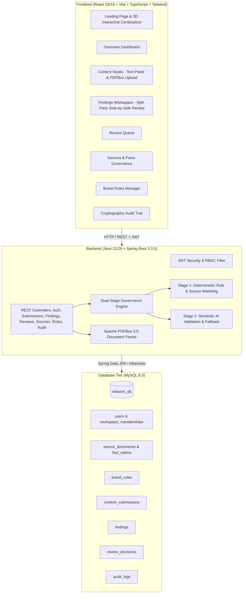

# INKLOOM AI
> *"Every piece of content. One trusted brand standard."*  
> **Team ASTRA3 Brand Governance & Content Validation Platform**

---

## 🌟 Executive Summary

**INKLOOM AI** is an enterprise-grade brand-governance and content-validation platform engineered by **Team ASTRA3**. It solves the critical enterprise risk of content drift, unapproved product claims, outdated technical metrics, and compliance breaches across multi-channel content pipelines.

Unlike generic grammar linters or unconstrained LLM wrappers, INKLOOM AI implements a **Dual-Engine Validation Pipeline**:
1. **Stage 1 — High-Precision Deterministic Engine**: Server-enforced matching against approved brand dictionaries, prohibited terminology, SLA guarantees, numerical threshold bounds, and source expiry timelines.
2. **Stage 2 — Semantic / AI Validation**: Contextual claim verification and nuance detection with transparent, graceful fallback when LLM keys are unconfigured.

The system features an interactive **Three.js 3D Governance Core**, real-time **PDF extraction (Apache PDFBox)**, **MySQL 8.0 ACID persistence**, **JWT Role-Based Access Control (RBAC)**, a split-pane **Findings Review Workspace**, and an immutable **Audit Trail**.

---

## 🏗️ System Architecture



---

## ⚡ Tech Stack

| Layer | Technology | Version | Purpose |
|---|---|---|---|
| **Backend** | Java | 21 / 25 | High-performance enterprise runtime |
| **Framework** | Spring Boot | 3.3.5 | Production REST API, Security, JPA |
| **Security** | Spring Security + JJWT | 0.12.6 | Stateless JWT authentication & method-level RBAC |
| **Document Engine** | Apache PDFBox | 3.0.3 | Native multi-page PDF text & metadata extraction |
| **Database** | MySQL | 8.0 | ACID relational storage on port 3306 |
| **Frontend** | React + Vite | 18 / 19 | Lightning-fast reactive single-page app |
| **Language** | TypeScript | 5.5 | Type safety across models, DTOs, and API clients |
| **3D Centerpiece** | Three.js + @react-three/fiber + drei | 0.169 | Real-time interactive 3D Governance Core |
| **Styling** | Tailwind CSS + Lucide Icons | 3.4 | Ultra-modern dark-first SaaS aesthetic (`#080B12`) |
| **Motion** | Framer Motion | 11.5 | Smooth micro-interactions and workspace transitions |

---

## 🔐 Role-Based Access Control (RBAC) & Seed Accounts

The platform comes pre-seeded with four dedicated personas representing real-world enterprise roles:

| Role | Name | Email | Password | Permissions |
|---|---|---|---|---|
| **REVIEWER** | Elena Rostova | `reviewer@inkloom.ai` | `Reviewer@123` | Review queue, findings approval/rejection/edits |
| **ADMIN** | Astra System Admin | `admin@inkloom.ai` | `Admin@123` | Full workspace settings, user invites, brand rules |
| **CREATOR** | Devon Vance | `creator@inkloom.ai` | `Creator@123` | Content Studio, text/PDF submissions, view own drafts |
| **SOURCE_OWNER** | Dr. Marcus Vance | `owner@inkloom.ai` | `Owner@123` | Certified source uploads, fact deprecation, SLAs |

> 💡 **Quick Login**: The application login screen includes 1-click quick-fill buttons for each of the 4 personas.

---

## 🚀 Quick Start Guide

### 1. Prerequisites
- **JDK 21 or JDK 25** (`java -version`)
- **Node.js 18+** (`node -v`) & **npm** (`npm -v`)
- **MySQL 8.0** service running on `localhost:3306` with database `inkloom_db`
- **Apache Maven 3.9+**

### 2. Database Setup
The backend automatically connects to MySQL:
- **Host**: `localhost:3306`
- **Database**: `inkloom_db`
- **User**: `root`
- **Password**: `root@2007` (configured in `backend/src/main/resources/application.properties`)

*On first startup, the backend automatically initializes all tables (`ddl-auto=update`) and seeds the complete Orbit Suite demo dataset if empty.*

### 3. One-Click Launch (Recommended)
From the project root folder:
```powershell
# Launches both Backend and Frontend in separate windows
.\start-all.ps1
```

Or start them individually:

#### Terminal 1 — Spring Boot Backend
```powershell
.\start-backend.ps1
# Or manually:
cd backend
mvn package -DskipTests
java -jar target/inkloom-backend-1.0.0-SNAPSHOT.jar
```
*Backend runs on `http://localhost:8080`* (Health check: `http://localhost:8080/api/health`).

#### Terminal 2 — Frontend Dev Server
```powershell
.\start-frontend.ps1
# Or manually:
cd frontend
npm install
npm run dev
```
*Frontend runs on `http://localhost:5173`*. All `/api/*` calls are automatically proxied to port 8080.

---

## 🧪 The Fictional Orbit Suite Demonstration Scenario

To showcase INKLOOM AI's governance capabilities, a fictional enterprise dataset is pre-seeded in MySQL:

1. **Approved Truth Sources**:
   - `Product Specification - Orbit Core Platform v3.0` (Certified Section 2.1: *"Supports up to 500 concurrent users"*).
   - `Global Customer SLA Guarantee` (Certified: *"99.9% uptime SLA guarantee"*).
   - `Security & Compliance Whitepaper` (SOC2 Type II & HIPAA certified).
   - `Legacy Orbit Beta Specification` (Expired 2023).

2. **Brand Rules**:
   - Approved Terminology: *"Orbit App"* is prohibited $\rightarrow$ use *"Orbit Suite"*.
   - Prohibited Claims: Absolute guarantees like *"guarantee 100% uptime"* are strictly prohibited.
   - Prohibited Hyperbole: *"instant magic"* is flagged $\rightarrow$ recommend *"automated intelligent validation"*.

3. **Submitted Draft Content**:
   > *"Meet Orbit Suite. Supports up to 5,000 users with simple onboarding. Our platform offers a guarantee 100% uptime for any organization. Try the new Orbit App today for instant magic."*

4. **Engine Findings Identified**:
   - `[CRITICAL]` `CLAIM_MISMATCH`: Claim states *"Supports up to 5,000 users"* $\rightarrow$ Source v3 Section 2.1 proves certified capacity is **500 users**.
   - `[CRITICAL]` `PROHIBITED`: Claim states *"guarantee 100% uptime"* $\rightarrow$ Corrected to *"99.9% uptime per SLA"*.
   - `[WARNING]` `TERMINOLOGY`: Draft uses *"Orbit App"* $\rightarrow$ Corrected to *"Orbit Suite"*.
   - `[WARNING]` `PROHIBITED`: Draft uses *"instant magic"* $\rightarrow$ Corrected to *"automated intelligent validation"*.
   - `[CRITICAL]` `SOURCE_EXPIRED`: Reference to legacy beta source flagged as expired.

---

## 🖥️ Screen & Feature Walkthrough

### 1. Landing Page (`/`)
- **3D Canvas**: Interactive Three.js particle core, orbiting document shards, and real-time raycasting inspection.
- **Workflow Pipeline**: 6-stage interactive timeline (Ingestion $\rightarrow$ Parse $\rightarrow$ Evidence Match $\rightarrow$ Risk Scoring $\rightarrow$ Review $\rightarrow$ Publish).
- **Orbit Suite Live Preview**: Interactive before-and-after comparison showing the 5,000 vs 500 user discrepancy.
- **Trust Principles**: Non-hallucinatory citations, deterministic safety bounds, and cryptographic auditability.

### 2. Overview Dashboard (`/dashboard`)
- Metric cards: Total Submissions, Pending Reviews, Open Findings, High-Severity Issues.
- Visual breakdown: Findings by category (Terminology, Prohibited, Claim Mismatch, Expired Source).
- Real-time engine status badge ("Dual Deterministic + Semantic Pipeline Active").
- Recent activity feed streaming live audit records.

### 3. Content Studio (`/studio`)
- Dual-input mode: Rich text editor / paste area OR drag-and-drop PDF upload.
- Native Apache PDFBox extraction: Extracts clean body text and metadata from uploaded documents.
- Live telemetry: Word counter, character counter, estimated reading time.
- Instant submission to the governance pipeline with immediate feedback.

### 4. Findings Workspace (`/findings`)
- **Split-Pane Review**: Left pane shows the highlighted submitted draft; right pane shows verified source excerpts side-by-side.
- Inline status tags: `VERIFIED_EVIDENCE`, `EXPIRED_SOURCE`, `MISSING_EVIDENCE`.
- Action bar for reviewers:
  - **Accept Correction**: Replaces draft excerpt with certified truth text.
  - **Edit Correction**: Allows custom reviewer modifications with rationale notes.
  - **Reject Finding**: Dismisses finding with required audit rationale.

### 5. Review Queue (`/queue`)
- Comprehensive table of all pending and completed submissions.
- Filter by status (`REVIEW_PENDING`, `APPROVED`, `REVISION_REQUIRED`, `REJECTED`).
- Risk badges indicating critical and warning counts.

### 6. Sources & Facts Governance (`/sources`)
- Catalog of all certified truth sources (Product Specs, SLAs, Whitepapers, Release Notes).
- Fact claims inspector: View certified claims extracted from each source document.
- Source lifecycle controls: Active, Under Review, Deprecated, Expired.

### 7. Brand Rules Manager (`/rules`)
- Management interface for Terminology, Prohibited Claims, and Regulatory rules.
- Severity configurator (Critical, Warning, Informational).
- Live rule creation and instant activation across the workspace.

### 8. Immutable Audit Trail (`/audit`)
- Chronological timeline of all workspace actions (`SUBMISSION_CREATED`, `ANALYSIS_COMPLETED`, `FINDING_REVIEWED`, `WORKSPACE_INITIALIZED`).
- Actor attribution with full user name, email, IP address, and precise timestamp.
- Non-repudiation cryptographic verification badge.

---

## 📡 REST API Reference

### Authentication
- `POST /api/auth/login` — Authenticate user and obtain JWT token
- `POST /api/auth/register` — Register new user
- `GET /api/auth/me` — Retrieve current authenticated profile

### Submissions & Ingestion
- `POST /api/submissions` — Create and analyze content (`application/json` or `multipart/form-data` with PDF)
- `GET /api/submissions?workspaceId={id}` — List all workspace submissions
- `GET /api/submissions/{id}` — Get submission details

### Findings & Analysis
- `GET /api/submissions/{id}/findings` — Get all findings for a submission
- `GET /api/findings?workspaceId={id}` — Get all findings across workspace
- `GET /api/findings/{id}` — Get single finding details

### Review Actions
- `POST /api/findings/{id}/review` — Review a finding (`ACCEPT`, `REJECT`, `EDIT`, `REVISE`)
- `GET /api/submissions/{id}/reviews` — Get decision history for a submission

### Sources Governance
- `GET /api/sources?workspaceId={id}` — List certified source documents
- `POST /api/sources` — Register new source document
- `PUT /api/sources/{id}` — Update source document
- `DELETE /api/sources/{id}` — Archive / deprecate source

### Brand Rules
- `GET /api/rules?workspaceId={id}` — List active brand rules
- `POST /api/rules` — Create new brand rule
- `PUT /api/rules/{id}` — Update existing brand rule

### Dashboard & Telemetry
- `GET /api/dashboard/stats?workspaceId={id}` — Aggregate metrics, category counts, audit feed
- `GET /api/health` — Platform health and engine status

---

## 🛡️ Automated Verification & Test Results

### 1. Spring Boot Backend Test Suite
```bash
mvn test
```
- `DeterministicGovernanceEngineTest`:
  - `testDetectProhibitedPhrasesAndTerminology()` — Passed ✅
  - `testDetectClaimMismatchAgainstSources()` — Passed ✅
- `InkloomApplicationTests`:
  - `testHealthEndpoint()` — Passed ✅

### 2. Frontend Production Build
```bash
npm run build
```
- Vite build completed with TypeScript compilation: `dist/index.html` and bundled assets generated cleanly with 0 type errors ✅.

### 3. End-to-End Dynamic Workflow Test
- Reviewer login $\rightarrow$ JWT issued ✅
- Review finding #4 (5,000 $\rightarrow$ 500 users) $\rightarrow$ Status updated to `ACCEPTED` in MySQL ✅
- Creator login $\rightarrow$ Submit new draft text $\rightarrow$ Real-time analysis generated 2 findings ✅
- Audit log persisted to MySQL with actor details and IP address ✅

---

## 👥 Team ASTRA3
- **Platform**: INKLOOM AI
- **Motto**: *"Every piece of content. One trusted brand standard."*
- **Competition MVP**: Hackday 2026 Ready
